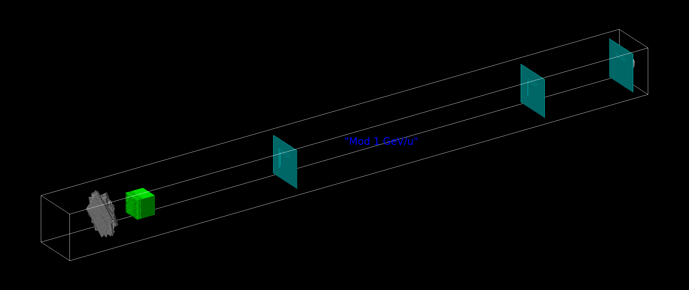
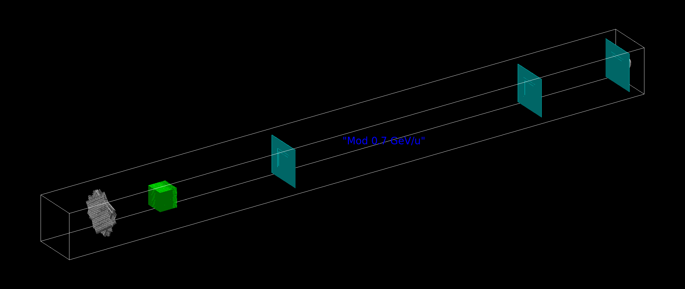
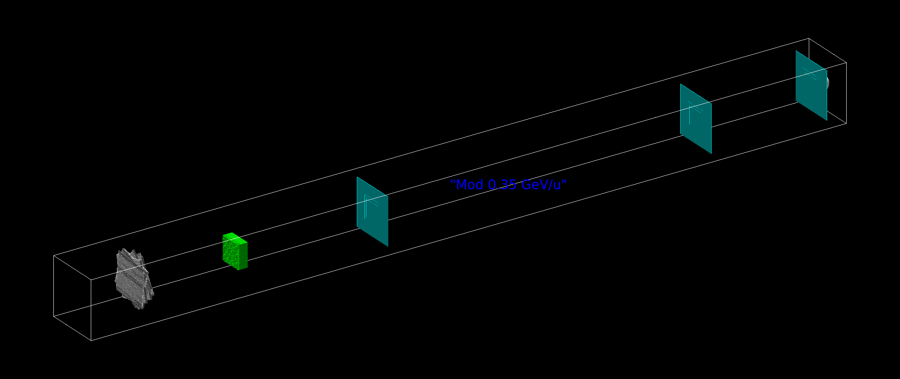
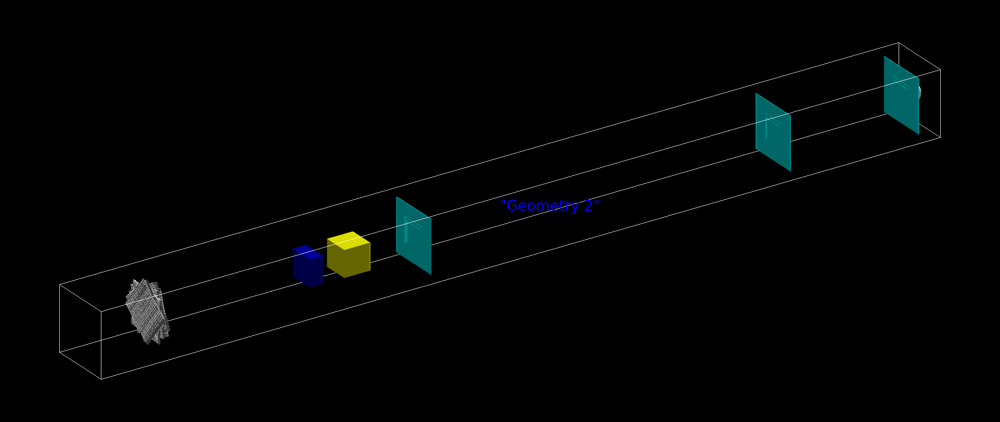
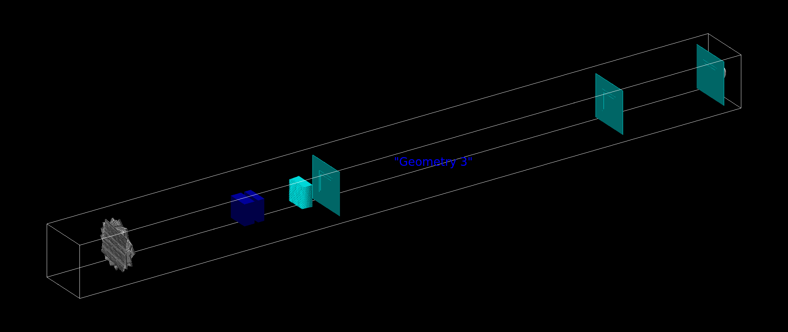
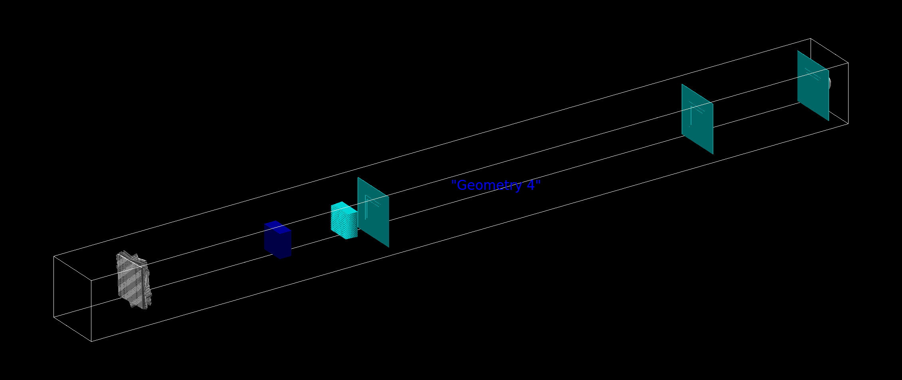

# Phase space documentation (2025 edition)

## Table of Contents

<h4>

1. [Introduction](#introduction)
2. [Simulated geometry](#simulated-geometry)
3. [Beam parameters](#beam-parameters)
4. [Benchmark of the generated Phase Space](#benchmark-of-the-generated-phase-space)
5. [How to use the Phase Space](#how-to-use-the-phase-space)

</h4>

## Introduction

Galactic Cosmic Radiation (GCR) pose a significant challenge in space exploration as radiation is considered one of the major obstacles due to its harmful nature to both electronic and biological material.
To study the effects of such radiation, a GCR-simulator has been developed [^fnGCR_sim_1].
By using combinations of different materials and well defined, complex, geometrical structures it is possible to reproduce the GCR field starting from a primary beam made only by pure iron-56.

By its very nature, GCR is extremely complex and mixed, both in terms of particle population and kinetic energy distribution, making both experimental and computational efforts very demanding.
In particular, Monte Carlo simulations based on Geant4 [^fngeant], can become very costly form the required resource prospective to such a level that is not accessible to every research institute.
To give a quantitative example, a primary particle is processed every 15 seconds of computational time.
To address this problem, the space radiation physics group at GSI has implemented a simplified approach, lifting the users from the actual computation of the generation of the GCR from the pure iron-56 beam.
In such way, the users can start their simulations from the mixed GCR field that GSI is capable of producing, removing a notable amount of resource requirements.
This approach is based on the so-called Phase Space (PS).

Geant4 is capable of starting Monte Carlo simulations in a variety of configurations that the user can specify. If the user chooses to specify these initial conditions as the GCR produced at GSI, then a simplified version of the Monte Carlo can be performed.
Again, the simplification comes from the fact that the interaction of the pure iron-56 beam with the modulators and materials does not need to be calculated by the user, as it has been already calculated.

One can define this PS approach as a two-steps simulation:

1. Generation of the PS. This is very demeaning in terms of resources and allows to define the initial conditions for a softer simulation:
2. The reshooting of the PS. This is less computationally intensive and gives users more freedom to implement their own Geant4 simulations according to their needs.

Assuming particles traveling along the $z$-axis, to correctly score a PS the minimum informations required are:

- Kinetic energy.
- $z$, $x$ and $y$ positions. The $z$ position is assumed fixed, as all the information is stored at once in a scoring plane in $(x, \, y)$
- $\theta$ angle: defined as the azimuthal angle of the vector momentum from the $z$ axis projected to the $(x, y)$ plane. $\theta \in \left[0, \pi \right]$
- $\phi$ angle: defined as the polar angles of the vector momentum in the $(x, \, y)$ plane.  $\phi \in \left[0, 2 \pi \right)$

This information is required all at once and for each particle species.
The contribution of isotopes is neglected and therefore the $Z$ (charge) can be used to uniquely identify the particles species.

Once all the information is available, it needs to be converted into a Geant4 marco (`.mac`) format. This script language allows to set up the second step of the simulations.

An internal tool has been developed to convert from Geant4 PS space to Geant4 macro.

It is important to underline that, by using this method the so-called **particle parenting is lost**.
In other words, the Geant4 definition of ''event'' of the simulations performed in step 1 is no longer propagated to the simulations of step 2.
This is because, the Geant4 macro only accepts distributions as an input. Consequentially, all the particles of the re-shooting of the PS will be treated as independent primary particles events, even if this is might not be the case in the simulation used to generate the PS.
This can affect scoring in simulations that are dependent of the definition of ''event'' like dose deposition scoring.

## Simulated geometry

The simulation setup consists of 6 different setups featuring different elements in the beamline.
A detailed description of the configurations will be available in the papers [^fnGCR_sim_1].
To sum up, three configurations are made of ''complex modulators'' while the remaining three are made of ''slab modulators''.
Additionally, two ''slab modulators'' configuration include an additional component to optimize the kinetic of the fragments (FRANCO).

1. $1\, \text{GeV}\,  \text{u}^{-1}$ complex modulator, identified in the naming convention as ''mod_1000''

1. $0.7\, \text{GeV}\,  \text{u}^{-1}$ complex modulator, identified in the naming convention ''mod_700''

3. $0.35\, \text{GeV}\,  \text{u}^{-1}$ complex modulator., identified in the naming convention ''mod_350''.

4. $0.35\, \text{GeV}\,  \text{u}^{-1}$ slab modulator, PE + steel, identified in the naming convention ''g2_350''.

5. $1\, \text{GeV}\,  \text{u}^{-1}$ slab modulator, 80 mm of steel + FRANCO, identified in the naming convention ''g3_1000''.

6. $1\, \text{GeV}\,  \text{u}^{-1}$ slab modulator, 50 mm of steel + FRANCO, identified in the naming convention ''g4_1000''.


The picture follow a specific color coding:

- *Grey* for the mesh. It should be pointed out that, due to the complexity of the mesh, a simplified version is shown as it cannot be visualized naively with the geant4.
- *Green* for complex modulators.
- *Dark blue* for steel material of the slab modulators.
- *Yellow* for PE material of the slab modulator.
- *Event-lighter* blue for FRANCO.
- *Light blue* for the scoring planes.

### Beam parameters

The beam shape has been choose to mimic a realistic raster scanning spanning and area of $8 \, \text{cm} \times 8 \, \text{cm}$.
The primary energy is modeled by a monoenergetic distribution having as the only component the nominal energy component.
No energy spread is introduced as well as no beam divergence is present on the source.

### Scoring options

Multiple scoring options were selected when generating the phase space. They can be identified by:

- Distance from the distal edge of the last element of the beamline (FRANCO modulator). The value of the distance is explicitly written in the file name and can be: `100`, `1500` or `2000` mm.
- Scoring plane dimensions. Can be selected from `normal`, `wide` and `very_wide` having the dimensions of: $75 \times 75 \, \text{mm}^2$, $100 \times 100\, \text{mm}^2$ and $200 \times 200 \, \text{mm}^2$.

## How to use the Phase Space

#### Getting the phase space

The users can be either provided by the Phase Space upon request, or, if they have access to this repository, they will find the phase spaces in the [macros/generated](../macros/generated) folder. The PSs are organized there by folder.
The following naming convention is adopted:

```bash
PS<configuration name>_<primary energy>_<..stuff..>_<distance>_<dimensions>
```

where:

- `<configuration name>` can be one of the convention name defined in [Simulated geometry](#simulated-geometry).
- `<primary energy>` refers to the primary beam energy in MeV/u.
- `<distance>` define the distance according to the name definition in [Scoring options](#scoring-options).
- `<dimensions>` define the scoring, and, in the case of reshoot, the source dimension to the name definition in [Scoring options](#scoring-options).

e.g. `PSg4_1000_50ST_DM_join_1500_very_wide/` containts the file of ''g4'' slab modulator at $1 \text{GeV}\, \text{u}^{-1}$, at 1500 mm from the last element of the beamline in with a scoring dimension of  $200 \times 200 \, \text{mm}^2$.

Additionally, a phase space made by the weighted joining of all the configurations, with the aim of reproducing directly the simulated GCR field is provided.
Such configuration is called `fullGCR`.

#### Using the phase space data

The PS files comprehend a total of $135$ macro files. Each file contains the distributions required to generate the PS for each $Z$ from 0 (neutrons) to 26 (iron).
The macro files contain the kinetic energy information, identifiable by the string `Ek` in the name, and also contain information about the particle type, relative abundance and spatial distributions.

The macro are automatically sourced by the `sim.mac` file. As a consequence, the user just needs to add the following line:

```
/control/execute sim.mac
```

After the simulation has been initialized, in other words, after the `/run/initialize` command has been invoked.
All the macro file are expected to be in the same folders as `sim.mac`.
A `run.mac` file is provided as an example on how to run the phase space.

The PS is shot along the $z$-axis and, according to the dimensions of the scoring that has been selected, the generation dimensions can differ. For this reason it is important that the Geant4 simulation is performed in a world big enough to contain the particle source dimensions to avoid artifacts.

### Important notes

#### Which configuration to use

The GCR simulator field is valid in the pane $(x,\, y, \, z) = ( \pm 3.75 \, \text{cm},\, \pm 3.75 \, \text{cm}, 2000\, \text{mm})$, meaning that the field is validated at $2$ m from the last element of the beamline.
Consequentially, it is advisable to use, when possible, configurations that are the closest to the target area: `normal` size and `2000` distance.
This is not always possible, and, for this reason, multiple PS versions are provided. If the setup dimensions do not allow to use the 2 m distance, the 1.5 m distance represents a valuable alternative.
The 100 mm can be a good choice if the user needs to simulate the full beamline after the GCR-simulators last element.
When coming to the lateral dimensions, the favorable choice is the `normal` or the `wide` dimensions, depending on the users' target size.
If the user is interested in the effects that might arise from the scattered radiation, then the `very_wide` setup can represent a good choice. It worth pointing out that this `very_wide` configuration is the least accurate in reproducing the GCR field at the target location due its multimodal characteristic distributions and edge effects.

#### Phase space source position

By default the particles are generated in a plane at $z = -200 \, \text{mm}$ with respect to the world center. This can be freely modified by the users according to their needs by changing the line in **all** `Ek` macros.

```
/gps/pos/centre 0 0 -200 mm  
```

This can be done with the `sed` command like in the following example:

```bash
find . -type f -name "*.mac" -exec sed -i 's/gps\/pos\/centre 0 0 -200 mm/gps\/pos\/centre 0 0 -100.8 cm/g' {} +
```

where `-200 mm` is substituted to `-100.8 cm`.

#### Benchmark of the generated Phase Space

A benchmark of the phase space is provided in this git repo under the [validation](validation/) folder.
To validate the PS, each configuration was used in a geant4 simulation featuring a scoring surface of the same parameters after 20 cm of space. The simulation was performed in vacuum and consequentially no backscattering is visible.
Additionally, the scoring surface is wider than the `very_wide` configuration, allowing to score the relevant particles.
To adjust the number of primary particles, a normalization factor is calculated for the protons and applied for all the other distributions.
Such normalization consists of the ratio between the original PS total counts in the kinetic energy histogram of the protons and the same value from the same histogram in the reshooted PS.
This normalization is the used to align all the distributions in amplitude to make the comparison more clear as well as a further consistency check.
For each scored quantity and for each charge, the input PS and the reshoot PS are compared.
All the validation PS were simulated with the `run.mac` available with the PS macros, having the same number of primaries: 500'000'000

#### Primary particles correspondence

Since the reshoot PS loses the parenting information of the original PS, a correction factor is required to match the number of reshoot particles to the original primary particles of the original PS.
Such value needs to be calculated for each configuration and accounts for the normalization factor calculated to validate the PS, the primary particles of the original PS and the primary particles used in the reshoot of the PS.
A csv file containing this conversion factors is provided in this folder under the name of `primaries.csv` [here](primaries.csv).
For each specific configuration, a different number of primary particles needs to be calculated. Such calculation is based on a normalization factor which is also used in the validation. This factor $\xi$ is such that the amplitude of the kinetic energy distribution for protons (Z = 1) matches the respective kinetic energy distribution before the reshoot. $\xi$ is common to all the Z of a specific configuration and is printed in all the plots of validation.
Given the number of primary particles used in the original simulation to generate the PS $N_i$ (i = input), and the number of primary particles used in the simulation of the validation $N_o$ (o = output), the normalization factor $\xi$ related these two quantities.
It is then possible to calculate a ''primary efficiency'', $\eta$, of the reshooted PS by:
$$
\eta = \xi \frac{N_o}{N_i}\, .
$$
In this way, $\eta$, can be used to calculate the correspondence between the required number of primaries needed for the reshoot to the original PS simulation:
$$
N_{\text{to shoot}} = \eta N_{\text{requested}}
$$
where $N_{\text{to shoot}}$ is the number particles to be used in the reshoot simulation and $N_{\text{requested}}$ is the number of particles required from the PS.

##### TL;DR

1. Pick a configuration of interest following the naming convention.
2. Copy the macros of the configuration to the geant4 binary folder. Assume configuration is g2, `normal`, `2000`
3. get the $\eta$ from the `primaries.csv`. Assume $\eta = 2.312$ as an example (**not the case**).
4. Fix the number of primary particles impinging on this configuration to be used in the simulations: $N_{\text{to shoot}} = 10'000$
5. Calculate the corresponding `/run/beamOn` particles to be used by the PS simulation with: $\eta N_{\text{to shoot}} = 10'000 \cdot 2.312 = 23120$
6. Run the simulation sourcing the `sim.mac`  in your marco and with  `/run/beamOn 23120` primaries.

[^fnGCR_sim_1]: Two publications are submitted. Preprints available here [Hybrid Active-Passive Galactic Cosmic Ray Simulator: in silico design and optimization](https://doi.org/10.48550/arXiv.2509.13171), [Hybrid Active-Passive Galactic Cosmic Ray Simulator: experimental implementation and microdosimetric characterization](https://doi.org/10.48550/arXiv.2509.13158)

[^fngeant]: [Geant 4 website](<https://geant4.web.cern.ch/>). Publications: - - - Recent Developments in Geant4, J. Allison et al., Nucl. Instrum. Meth. A 835 (2016) 186-225 - - - Geant4 Developments and Applications, J. Allison et al., IEEE Trans. Nucl. Sci. 53 (2006) 270-278 - - - Geant4 - A Simulation Toolkit, S. Agostinelli et al., Nucl. Instrum. Meth. A 506 (2003) 250-303
